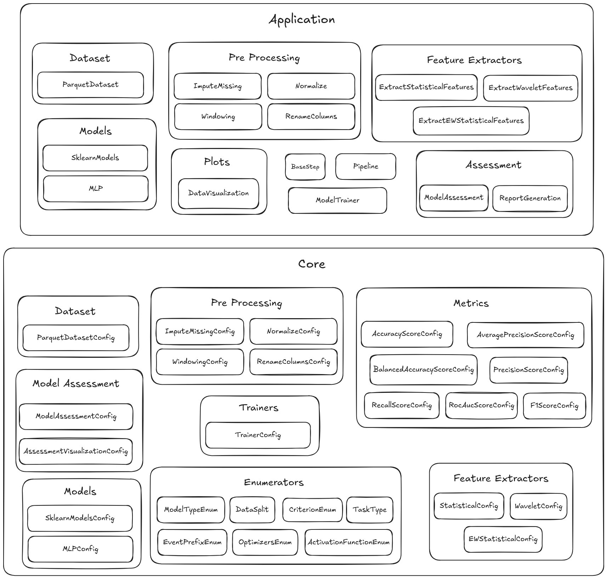
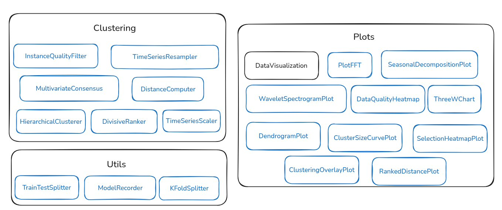

[November 16th, 2026] ~ 25 minutes

---

# Introduction to 3W Toolkit 3.2.1

### 🧰 What the 3W Toolkit is

The 3W Toolkit is a collection of tools to explore time series, train models and look for insights in them. It was designed around the 3W Dataset, but it is not limited to it: every step works on a pandas DataFrame wrapped in a `DatasetOutputs`, so the same tools apply to other time series datasets and to other problems and tasks (classification, regression, clustering).

What it offers:
- **Loading data**: the 3W Parquet files with filters by event class and source, CSV files, subsets and lazy transforms.
- **Exploring data**: time series plots, correlation, FFT, seasonal decomposition, wavelet spectrograms, data quality heatmaps and the 3W chart.
- **Preparing data**: cleaning, imputation, normalization, renaming, label filling and class remapping.
- **Extracting features**: windowing, statistical, exponentially weighted and wavelet features, alone or combined.
- **Training models**: scikit-learn models, an MLP and any PyTorch model, with train/test and k-fold splits.
- **Evaluating models**: classification and regression metrics, assessment figures and HTML/LaTeX reports.
- **Finding structure** (new): clustering of instances, for example to compare real and simulated events.
- **Running it end to end**: one `PipelineConfig` from raw files to an evaluated model.


---

### Agenda:

1. [Architecture](#architecture)
2. [Installation](#installation)
3. [Resources](#resources)
4. [Documentation](#documentation)

---

<a id="architecture"></a>

## 🧭 Architecture

The 3W Project has two versioned parts:

- The **3W Dataset** is the collection of Parquet files. 
- The **3W Toolkit** is the Python package that loads that data and runs experiments on it.

This session presents toolkit version **3.2.1**. The dataset is not going to be covered in this presentation.

The previous hands-on introduction is [Introduction to 3WToolkit v2.0.0](../introduction_to_3w_toolkit_v2.0.0/README.md): 8 notebooks, from an overview through a full pipeline. This session shows what that package became. Areas added since those notebooks are marked **(new)**.

### 🗂️ Submodules

- **`core`**: the base classes every component inherits from (`BaseDataset`, `BasePreprocessing`, `BaseFeatureExtractor`, `BaseModels`, `BaseTrainer`, `BaseAssessment`, `BasePipeline`), their base config classes, `Instantiable.build`, `DatasetOutputs` and the enumerators in `enums.py`.
- **`dataset`**: loads the instances. `ParquetDataset` reads the 3W Parquet files and downloads the dataset when missing. Subsets, lazy transforms and `load_csv` also live here.
- **`preprocessing`**: cleans and prepares the signals: imputation, normalization, renaming, signal cleaning, label filling and class remapping.
- **`feature_extraction`**: turns signal windows into feature tables, plus adapters that chain or concatenate extractors.
- **`models`**: model wrappers with one interface: scikit-learn models, the MLP and a generic PyTorch wrapper.
- **`trainer`**: the training loop, separate from the model: `SklearnTrainer` and `TorchTrainer`.
- **`assessment`**: evaluates a trained model on test data and produces the metric table and figures.
- **`metrics`**: classification and regression metric functions.
- **`data_visualization`**: plots for the series, the signals' quality and the clustering results.
- **`clustering`** (new): groups instances by similarity.
- **`reports`**: HTML and LaTeX reports from the results.
- **`pipeline`**: `Pipeline` chains dataset, preprocessing, features, trainer and assessment.
- **`utils`**: train/test and k-fold splitters, model save and load, and other helpers.

A `ParquetDataset` is the collection of instances; it holds the selected file paths, not the data. Indexing it (`dataset[i]`) reads one file and returns one `DatasetOutputs`.

Full class diagram of the current toolkit (JOSS paper):


Main modules of the toolkit in 2.0.0:



### ✨ What is new since the 2.0.0 workshop?




| Module               | Config                                 | Class                                                                                                                                                                                   | What it adds                                     |
| -------------------- | -------------------------------------- | --------------------------------------------------------------------------------------------------------------------------------------------------------------------------------------- | ------------------------------------------------ |
| `preprocessing`      | `CleanSignalsConfig`                   | `CleanSignals`                                                                                                                                                                          | Signal cleaning                                  |
| `preprocessing`      | `FillLabelsConfig`                     | `FillLabels`                                                                                                                                                                            | Label filling                                    |
| `preprocessing`      | `RemapClassConfig`                     | `RemapClass`                                                                                                                                                                            | Class remapping                                  |
| `preprocessing`      | `SequentialPreprocessingAdapterConfig` | `SequentialPreprocessingAdapter`                                                                                                                                                        | A chain of preprocessing steps                   |
| `feature_extraction` | `WindowingConfig`                      | `Windowing`                                                                                                                                                                             | Windowing, moved here from preprocessing         |
| `feature_extraction` | `ConcatFeatureAdapterConfig`           | `ConcatFeatureAdapter`                                                                                                                                                                  | Several extractors, one table                    |
| `feature_extraction` | `SequentialFeatureAdapterConfig`       | `SequentialFeatureAdapter`                                                                                                                                                              | Extractors in sequence                           |
| `models`             | `TorchModelsConfig`                    | `TorchModels`                                                                                                                                                                           | PyTorch model wrapper                            |
| `trainer`            | `SklearnTrainerConfig`                 | `SklearnTrainer`                                                                                                                                                                        | Training split out of the model                  |
| `trainer`            | `TorchTrainerConfig`                   | `TorchTrainer`                                                                                                                                                                          | PyTorch training loop                            |
| `clustering`         | scikit-learn style, no Config          | `InstanceQualityFilter`, `TimeSeriesResampler`, `TimeSeriesScaler`, `DistanceComputer`, `HierarchicalClusterer`, `DivisiveRanker`, `MultivariateConsensus`                              | Whole module. Helper: `compute_dba_centroid`     |
| `data_visualization` | constructed directly                   | `PlotSeries`, `PlotMultipleSeries`, `CorrelationHeatmap`, `PlotFFT`, `SeasonalDecompositionPlot`, `WaveletSpectrogramPlot`                                                              | 2.0.0 methods of `DataVisualization`, now classes |
| `data_visualization` | constructed directly                   | `ThreeWChart`, `DataQualityHeatmap`                                                                                                                                                     | The 3W chart, data quality                       |
| `data_visualization` | constructed directly                   | `DendrogramPlot`, `ClusterSizeCurvePlot`, `SelectionHeatmapPlot`, `ClusteringOverlayPlot`, `RankedDistancePlot`                                                                         | Clustering views                                 |
| `metrics`            | functions                              | `matthews_corrcoef`                                                                                                                                                                     | New metric. The metric config classes were removed |
| `dataset`            | `TransformConfig`                      | `TransformDataset`, `TransformedDataset`, `SubsetDataset`                                                                                                                               | Subsets and lazy transforms                      |
| `dataset`            | —                                      | `load_csv`                                                                                                                                                                              | Moved here from the `data_loader` module         |
| `utils`              | —                                      | `TrainTestSplitter`, `KFoldSplitter`                                                                                                                                                    | Splits, replacing `TimeSeriesHoldout`            |
| `pipeline`           | `PipelineConfig`                       | `Pipeline`                                                                                                                                                                              | The pipeline now has a config                    |
| `core`               | —                                      | `Instantiable.build`, `DatasetOutputs`                                                                                                                                                  | The public construction pattern, replacing `BaseStep` |
| `core`               | —                                      | `DistanceMetricEnum`, `LinkageMethodEnum`, `AvailableWaveletsEnum`, `AvailableStatisticalFeaturesEnum`, `AvailableEWStatisticalFeaturesEnum`                                            | New enumerators                                  |


### What's important

- `ModelTrainer` (with `ModelTrainerConfig` and `TrainerConfig`) was replaced with `SklearnTrainer`/`SklearnTrainerConfig` and `TorchTrainer`/`TorchTrainerConfig`.
- New classes supporting the torch models: `TorchModels` / `TorchModelsConfig`. `MLPConfig` now inherits from `TorchModelsConfig`.
- Added new classes supporting the dataset: `TransformDataset`, `TransformedDataset`, `SubsetDataset` and `TransformConfig`. The function `load_csv` moved into `dataset`.
- New classes supporting the preprocessing: `CleanSignals`, `FillLabels`, `RemapClass`, `SequentialPreprocessingAdapter`, each with its config.
- New classes supporting the feature extractor: `ConcatFeatureAdapter`, `SequentialFeatureAdapter`. 
- Each config now lives next to its class. In 2.0.0 the notebooks imported configs from `core` (`from ThreeWToolkit.core.base_preprocessing import NormalizeConfig`). In 3.2.1 they come from the submodule (`from ThreeWToolkit.preprocessing import NormalizeConfig`).
- Some enumerators were renamed: `TaskType` is now `TaskTypeEnum` and `DataSplit` is now `DataSplitEnum`.

#### Migrating code from 2.0.0

1. Import each config from its submodule, not from `ThreeWToolkit.core`.
2. Rename the feature extractors: `ExtractStatisticalFeatures` → `StatisticalFeatures`, and the same for wavelet and EW statistical features.
3. Replace `ModelTrainer` with `SklearnTrainer` or `TorchTrainer`.
4. Read samples as attributes (`sample.signal`) instead of dictionary keys (`sample["signal"]`).
5. Replace `DataVisualization.plot_series(...)` and the other static methods with the plot classes (`PlotSeries`, ...).

In v2.0.0, each instance returned by the dataset (`dataset[i]`) was a dictionary with `"signal"` and `"label"` keys. In v3.2.1, each instance (one Parquet file) is a `DatasetOutputs` object with three fields:

| Field      | Content                   |
| ---------- | ------------------------- |
| `signal`   | A pandas DataFrame        |
| `label`    | A pandas Series, or `None` when no target column is set |
| `metadata` | A dictionary (`file_name`, `event_class`, `event_type`) |


Preprocessing steps and feature extractors share one method: `transform(DatasetOutputs) -> DatasetOutputs`. It returns a new `DatasetOutputs` and never modifies the one passed in. You can therefore chain steps, or try several on the same instance, without reloading it from disk. [Example 1](02_examples_and_contributing.md#example-1--config-build-transform) in the next session shows this with `RenameColumns`.

```python
step = RenameColumnsConfig(columns_map={"P-PDG": "pressure"}).build()
renamed = step.transform(sample)  # new DatasetOutputs, column renamed
sample.signal.columns  # still has "P-PDG"
renamed.signal.columns  # has "pressure"
```

The long form of this architecture is the [Architecture Overview](../../3W_TOOLKIT_CONTRIBUTING.md#architecture-overview) in the toolkit contributing guide.


### ✅ Classes the 2.0.0 already showed

These still exist in 3.2.1, under the names below. The feature extractors were renamed (see the table in [Notebooks](#resources)), and the configs moved next to their classes.


| Module               | Config                  | Class                                                                         |
| -------------------- | ----------------------- | ----------------------------------------------------------------------------- |
| `dataset`            | `ParquetDatasetConfig`  | `ParquetDataset`                                                              |
| `preprocessing`      | `ImputeMissingConfig`   | `ImputeMissing`                                                               |
| `preprocessing`      | `NormalizeConfig`       | `Normalize`                                                                   |
| `preprocessing`      | `RenameColumnsConfig`   | `RenameColumns`                                                               |
| `feature_extraction` | `StatisticalConfig`     | `StatisticalFeatures`                                                         |
| `feature_extraction` | `WaveletConfig`         | `WaveletFeatures`                                                             |
| `feature_extraction` | `EWStatisticalConfig`   | `EWStatisticalFeatures`                                                       |
| `models`             | `SklearnModelsConfig`   | `SklearnModels`                                                               |
| `models`             | `MLPConfig`             | `MLP`                                                                         |
| `data_visualization` | —                       | `DataVisualization`                                                           |
| `assessment`         | `ModelAssessmentConfig` | `ModelAssessment`                                                             |
| `assessment`         | `AssessmentVisualizationConfig` | `AssessmentVisualization`                                             |
| `metrics`            | functions               | `accuracy_score`, `balanced_accuracy_score`, `precision_score`, `recall_score`, `f1_score`, `roc_auc_score`, `average_precision_score`, `explained_variance_score` |
| `reports`            | —                       | `ReportGeneration`                                                            |
| `pipeline`           | —                       | `Pipeline`                                                                    |
| `utils`              | —                       | `ModelRecorder`                                                               |


---


<a id="installation"></a>

## 📦 Three ways to install

### 🐍 Use the toolkit hosted in PyPI

This install is enough to import the library. The repository stays where it is.

The project name is **3W**. The package name on PyPI is **ThreeWToolkit**, because a package name cannot start with a digit: [https://pypi.org/project/ThreeWToolkit/](https://pypi.org/project/ThreeWToolkit/)

Install [uv](https://docs.astral.sh/uv/getting-started/installation/) once per machine:

```bash
# Linux and macOS
curl -LsSf https://astral.sh/uv/install.sh | sh
```

```powershell
# Windows (PowerShell)
powershell -ExecutionPolicy ByPass -c "irm https://astral.sh/uv/install.ps1 | iex"
```

Create a virtual environment with Python 3.10 or newer and activate it:

```bash
uv venv .venv --python 3.12
source .venv/bin/activate        # Windows: .venv\Scripts\activate
```

`uv` downloads that Python version if it is not on the machine. With the environment active, install the toolkit:

```bash
uv pip install ThreeWToolkit
```

An environment created by `uv venv` has no `pip` inside it. To use plain `pip install ThreeWToolkit` instead, create the environment with `uv venv .venv --python 3.12 --seed`, which adds `pip`.

Check the installed version:

```bash
python -c "import ThreeWToolkit; print(ThreeWToolkit.__version__)"
# 3.2.1
```

Before the hands-on session, load one instance to check that everything works. The first load downloads the 3W Dataset from Figshare, which takes a while, so do it ahead of time:

```python
from ThreeWToolkit.dataset import ParquetDatasetConfig

dataset = ParquetDatasetConfig(path="dataset", target_class=[1]).build()
sample = dataset[0]
print(len(dataset), sample.signal.shape, sample.metadata)
```

Optional extras (`dev`, `docs`, `notebooks`, `images`, `scikit-extras`, `torch-extras`) are installed with `uv` too, by adding them in brackets. Quotes keep shells like `zsh` from reading the brackets as a pattern:

```bash
uv pip install "ThreeWToolkit[torch-extras]"
uv pip install "ThreeWToolkit[docs,notebooks]"
```

What each extra adds is in [Optional dependency groups](#-optional-dependency-groups).


### 📥 Read the examples from a clone

```bash
git clone git@github.com:petrobras/3W.git
cd 3W
uv sync --locked
source .venv/bin/activate
```

`uv sync --locked` creates `.venv` and installs the versions recorded in `uv.lock`. On Windows the activation script is `.venv\Scripts\activate`.

### 🔧 Change the toolkit from a fork (recommended)

Fork [github.com/petrobras/3W](https://github.com/petrobras/3W), then clone that fork from your account and install the development extra:

```bash
git clone git@github.com:<your-username>/3W.git
cd 3W
uv sync --locked --extra dev
source .venv/bin/activate
```

**Clone or fork?** A clone is a local copy of a repository on your machine. Cloning `petrobras/3W` directly is enough to read and run the code, but you cannot push to it: only the maintainers have write access. A fork is your own copy of the repository on GitHub, under your account. You clone the fork, push your branches to it, and open a pull request from it to `petrobras/3W`. That is why we recommend a fork for contributors: you can push and share work in progress freely, and the official repository changes only when a maintainer merges the pull request. To keep the fork up to date, add the official repository as a second remote (`git remote add upstream git@github.com:petrobras/3W.git`) and pull from `upstream/dev`.

Creating the branch, running lint and tests, and opening the pull request against `dev` are in [Examples and contributing](02_examples_and_contributing.md).

### 🎁 Optional dependency groups

The base install covers classical models and the MLP. Extra groups live in `pyproject.toml`. Install the group that matches the task.


| Extra           | From a clone                             | What it adds                                     |
| --------------- | ---------------------------------------- | ------------------------------------------------ |
| `dev`           | `uv sync --locked --extra dev`           | pytest, mypy, ruff, Jupyter. Used to contribute. |
| `docs`          | `uv sync --locked --extra docs`          | Sphinx and the Read the Docs theme.              |
| `notebooks`     | `uv sync --locked --extra notebooks`     | Kernel, widgets, nbconvert.                      |
| `images`        | `uv sync --locked --extra images`        | Figure export (kaleido, svgwrite, and others).   |
| `scikit-extras` | `uv sync --locked --extra scikit-extras` | `scikit-image`.                                  |
| `torch-extras`  | `uv sync --locked --extra torch-extras`  | torchvision, torchmetrics, timm.                 |
| all of them     | `uv sync --locked --all-extras`          | Every group above.                               |


From PyPI, the same groups use brackets.

```bash
uv pip install "ThreeWToolkit[dev]"
uv pip install "ThreeWToolkit[docs,notebooks]"
```

Lint and tests need the `dev` extra. Those commands are in the next session.

---


<a id="resources"></a>

## 📚 Notebooks

Each area has a demo notebook under [toolkit/demos/](../../toolkit/demos/). The same notebooks are rendered in the Read the Docs tutorials. The chain from Parquet to a trained model is the [Quickstart](https://threewtoolkit.readthedocs.io/en/latest/quickstart.html), covered in the next session.


| Area                       | Notebook                                                                                                                                                                                                                     |
| -------------------------- | ---------------------------------------------------------------------------------------------------------------------------------------------------------------------------------------------------------------------------- |
| Overview                   | [00_overview.ipynb](../../toolkit/demos/00_overview.ipynb)                                                                                                                                                                 |
| Dataset                    | [01_dataset_examples.ipynb](../../toolkit/demos/01_dataset_examples.ipynb)                                                                                                                                                 |
| Plots                      | [02_data_visualization.ipynb](../../toolkit/demos/02_data_visualization.ipynb), [14_three_w_chart_example.ipynb](../../toolkit/demos/14_three_w_chart_example.ipynb)                                                     |
| Cleaning and preprocessing | [03_data_cleaning_examples.ipynb](../../toolkit/demos/03_data_cleaning_examples.ipynb), [04_preprocessing_examples.ipynb](../../toolkit/demos/04_preprocessing_examples.ipynb)                                           |
| Features                   | [05_feature_extraction_examples.ipynb](../../toolkit/demos/05_feature_extraction_examples.ipynb)                                                                                                                           |
| Clustering (new)           | [06_clustering_pipeline_examples.ipynb](../../toolkit/demos/06_clustering_pipeline_examples.ipynb), [07_clustering_real_vs_simulated_examples.ipynb](../../toolkit/demos/07_clustering_real_vs_simulated_examples.ipynb) |
| Models and training        | [08_sklearn_models_examples.ipynb](../../toolkit/demos/08_sklearn_models_examples.ipynb), [09_mlp_timeseries_example.ipynb](../../toolkit/demos/09_mlp_timeseries_example.ipynb)                                         |
| Save and load              | [10_load_save_model_examples.ipynb](../../toolkit/demos/10_load_save_model_examples.ipynb)                                                                                                                                 |
| Assessment and metrics     | [11_assessment_examples.ipynb](../../toolkit/demos/11_assessment_examples.ipynb), [12_using_metrics.ipynb](../../toolkit/demos/12_using_metrics.ipynb)                                                                   |
| Reports                    | [13_report_generation_examples.ipynb](../../toolkit/demos/13_report_generation_examples.ipynb)                                                                                                                             |


The older notebooks already included a dataset loader, imputation, normalization, renaming, statistical and wavelet features, scikit-learn models, an MLP, a few plots, assessment, a report, and a pipeline. Installation in that material used `pip` or `uv pip`, with no lock file.

Names from the 2.0.0 notebooks, and the names in 3.2.1:


| In the 2.0.0          | In 3.2.1                                        |
| ------------------------------ | ----------------------------------------------- |
| `ExtractStatisticalFeatures`   | `StatisticalConfig` / `StatisticalFeatures`     |
| `ExtractWaveletFeatures`       | `WaveletConfig` / `WaveletFeatures`             |
| `ExtractEWStatisticalFeatures` | `EWStatisticalConfig` / `EWStatisticalFeatures` |
| `ModelTrainer`                 | `SklearnTrainer` and `TorchTrainer`             |
| `pip install`, no lock file    | `uv sync --locked`, versions pinned in `uv.lock` |

---


<a id="documentation"></a>

## 📖 Documentation

The published documentation is [https://threewtoolkit.readthedocs.io/en/latest/](https://threewtoolkit.readthedocs.io/en/latest/)


| Section                                                                                      | What it contains                                                 |
| -------------------------------------------------------------------------------------------- | ---------------------------------------------------------------- |
| [Installation](https://threewtoolkit.readthedocs.io/en/latest/installation.html)             | The three profiles and the extras.                               |
| [Quickstart](https://threewtoolkit.readthedocs.io/en/latest/quickstart.html)                 | One `PipelineConfig` from Parquet to a trained MLP.              |
| [User Guide](https://threewtoolkit.readthedocs.io/en/latest/user_guide/index.html)           | Dataset, preprocessing, features, models, evaluation, reporting. |
| [Tutorials](https://threewtoolkit.readthedocs.io/en/latest/tutorials/index.html)             | The `toolkit/demos/` notebooks, rendered.                        |
| [API](https://threewtoolkit.readthedocs.io/en/latest/api.html)                               | The classes and configs from this session.                       |
| [Developer Guide](https://threewtoolkit.readthedocs.io/en/latest/developer_guide/index.html) | Architecture and the contribution rules.                         |


How to call a class: the API and the User Guide. How to add a class: the Developer Guide and [3W_TOOLKIT_CONTRIBUTING.md](../../3W_TOOLKIT_CONTRIBUTING.md).

---

Next session: [Examples and contributing](02_examples_and_contributing.md).