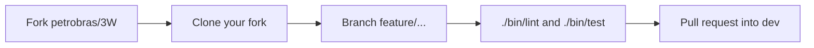

# Introduction to 3W Toolkit 3.2.1

## Examples and contributing

This session is on 17 November 2026 and is expected to last 35 minutes. The first session, [Architecture and installation](01_architecture_and_installation.md), is on 16 November 2026 and is expected to last 25 minutes.

Four points from that session:

1. A step is a config plus a class: `SomeConfig(...).build()`.
2. Steps exchange a `DatasetOutputs` with `signal`, `label`, and `metadata`.
3. Install with `pip install ThreeWToolkit`, clone and `uv sync --locked`, or fork and `uv sync --locked --extra dev`.
4. The documentation is https://threewtoolkit.readthedocs.io/en/latest/ .

The examples below use a small table written in the session. They leave the 3W Dataset untouched. The demo notebooks and the Quickstart are where that dataset is loaded.

Confirm the import before the examples:

```bash
python -c "import ThreeWToolkit; print(ThreeWToolkit.__version__)"
# 3.2.1
```

`PlotSeries` opens a matplotlib window. In Jupyter the figure appears in the notebook. In a terminal without a display, save it with `plt.savefig("pressure.png")`.

---

## Example 1 — config, build, transform

`RenameColumns` is a complete step with no `fit`. The config builds the step, `transform` returns a new sample, and the input keeps its original column name.

```python
import pandas as pd

from ThreeWToolkit.core import DatasetOutputs
from ThreeWToolkit.preprocessing import RenameColumnsConfig

data = DatasetOutputs(
    signal=pd.DataFrame({"P-PDG": [1.0, 2.0, 3.0]}),
    label=None,
    metadata={"source": "workshop"},
)

step = RenameColumnsConfig(columns_map={"P-PDG": "pressure"}).build()
out = step.transform(data)

print("input columns: ", list(data.signal.columns))
print("output columns:", list(out.signal.columns))
```

```text
input columns:  ['P-PDG']
output columns: ['pressure']
```

- `DatasetOutputs` is the object every step accepts.
- `RenameColumnsConfig` checks the mapping before any work runs.
- `.build()` returns the `RenameColumns` object. That is the mechanism in [`.agents/skills/add-toolkit-component/SKILL.md`](../../.agents/skills/add-toolkit-component/SKILL.md).
- `transform` returns a new sample. `data` still has the column `P-PDG`.

`Normalize` has the same shape and needs `fit` on a whole dataset before `transform`. That example is in [`04_preprocessing_examples.ipynb`](../../toolkit/demos/04_preprocessing_examples.ipynb).

An import error means `.venv` is inactive, or the package is not installed. The three install profiles are in [Architecture and installation](01_architecture_and_installation.md).

---

## Example 2 — impute and plot

Constant imputation fills the gap with `0.0` and does not need `fit`. `PlotSeries` then draws the filled series. Plots are constructed directly. They have no config class.

```python
import matplotlib.pyplot as plt
import pandas as pd

from ThreeWToolkit.core import DatasetOutputs
from ThreeWToolkit.data_visualization import PlotSeries
from ThreeWToolkit.preprocessing import ImputeMissingConfig

data = DatasetOutputs(
    signal=pd.DataFrame({"pressure": [10.0, None, 30.0, 40.0]}),
    label=None,
    metadata={},
)

filled = ImputeMissingConfig(strategy="constant", fill_value=0.0).build()
out = filled.transform(data)

print("input:")
print(data.signal)
print("output:")
print(out.signal)

plot = PlotSeries(
    series=out.signal["pressure"],
    title="Pressure after constant imputation",
    xlabel="sample",
    ylabel="pressure",
)
plot.plot()
plt.show()
```

```text
input:
   pressure
0      10.0
1       NaN
2      30.0
3      40.0

output:
   pressure
0      10.0
1       0.0
2      30.0
3      40.0
```

The input still has the missing value. The output has `0.0` in its place. The figure is the series with a dip at the second sample. `mean`, `ffill`, `bfill`, and `interpolate` are the same class with another `strategy`. `mean` needs `fit` first.

Further plots, including those added since the 2.0.0 workshop (`ThreeWChart`, FFT, wavelet spectrogram, clustering charts), are in [`02_data_visualization.ipynb`](../../toolkit/demos/02_data_visualization.ipynb) and [`14_three_w_chart_example.ipynb`](../../toolkit/demos/14_three_w_chart_example.ipynb).

---

## The same pattern, composed

A full pipeline downloads the dataset and trains a model. The shape of that pipeline is the [Quickstart](https://threewtoolkit.readthedocs.io/en/latest/quickstart.html). The same story opens [`00_overview.ipynb`](../../toolkit/demos/00_overview.ipynb).

`PipelineConfig` chains the classes from the first session:

1. `ParquetDatasetConfig` loads real, simulated, or hand-drawn files.
2. `SequentialPreprocessingAdapterConfig` chains `CleanSignalsConfig`, `FillLabelsConfig`, `RemapClassConfig`, `NormalizeConfig`, and `ImputeMissingConfig`. The adapter and the first three steps are new since the 2.0.0 workshop.
3. `WindowingConfig` cuts the series. Windowing now lives in feature extraction.
4. `SequentialFeatureAdapterConfig` and `ConcatFeatureAdapterConfig` run `StatisticalConfig`, `EWStatisticalConfig`, and `WaveletConfig`. Both adapters are new.
5. `MLPConfig` is the model. `TorchTrainerConfig` trains it. `SklearnTrainerConfig` is the pair for scikit-learn models. Both trainers are new. The 2.0.0 notebooks had a single `ModelTrainer`.

One config describes the experiment. `.build()` creates the `Pipeline`. Each piece is the same kind of object as in the two examples: a config, then `.build()`, then a new `DatasetOutputs`.

---

## How to contribute

Toolkit changes follow [3W_TOOLKIT_CONTRIBUTING.md](../../3W_TOOLKIT_CONTRIBUTING.md). The short version, also used by coding agents, is [add-toolkit-component](../../.agents/skills/add-toolkit-component/SKILL.md) and [run-quality-checks](../../.agents/skills/run-quality-checks/SKILL.md). The repository is https://github.com/petrobras/3W .

### Before the first pull request

- [CODE_OF_CONDUCT.md](../../CODE_OF_CONDUCT.md)
- [CONTRIBUTOR_LICENSE_AGREEMENT.md](../../CONTRIBUTOR_LICENSE_AGREEMENT.md)
- [CONTRIBUTING.md](../../CONTRIBUTING.md)

The pull-request form asks for a Contributor License Agreement, individual or corporate.

Questions go to [GitHub Discussions](https://github.com/petrobras/3W/discussions). Issues are for bugs and proposed changes.

### Fork, branch, pull request

Toolkit pull requests target the **`dev`** branch.



Fork the repository on GitHub, then:

```bash
git clone git@github.com:<your-username>/3W.git
cd 3W
git checkout dev
git pull
git checkout -b feature/short-name
```

| Branch | Use |
|--------|-----|
| `feature/<name>` | A new model, preprocessing step, or feature extractor |
| `bugfix/<name>` | A fix |
| `docs/<name>` | Documentation |
| `refactor/<name>` | A restructure with the same behavior |

One pull request, one change. A commit message looks like this:

```text
feat(preprocessing): add a clip step for sensor ranges

Clip each signal column to the bounds declared on the config.
```

Common types are `feat`, `fix`, `docs`, `test`, and `refactor`.

On the pull request, the base repository is `petrobras/3W` and the base branch is `dev`. The description includes the CLA confirmation.

Dataset overviews, citations, and benchmark notebooks are described in [CONTRIBUTING.md](../../CONTRIBUTING.md). A new toolkit class still uses the config, the tests, and a pull request into `dev`.

### Lint and tests

Install the `dev` extra first:

```bash
uv sync --locked --extra dev
```

From the repository root, the two commands CI runs:

```bash
CI=false ./bin/lint
./bin/test
```

| Command | What it does |
|---------|--------------|
| `CI=false ./bin/lint` | Local mode. mypy and ruff. Ruff may fix style issues. |
| `./bin/lint` | CI mode. The same checks, without auto-fix. |
| `./bin/test` | pytest and coverage. Skips tests marked `slow`. |
| `RUN_SLOW_TESTS=1 ./bin/test` | Also the tests that read the real Parquet dataset. |
| `pytest tests/preprocessing/test_normalize.py -v` | One module, while editing. |

`./bin/nb_test` executes the demo notebooks. It is slow. Run it when a change touches a notebook or a class those notebooks import.

A test that needs files under `dataset/` fails in CI, because that checkout has no Parquet files. Use `mock_dataset_factory` from `tests/conftest.py`, or mark the test `slow`.

When `pyproject.toml` changes, run `uv lock` and commit `uv.lock` with the change. CI installs with `uv sync --locked`.

---

## What is coming next

The list we are working from is [BACKLOG.md](../../BACKLOG.md). Read the Docs is already published, so that item is in the session above. Still ahead:

**Toolkit**

- Benchmarks so two solutions can be compared on the same task.
- A shared way to validate a model on those benchmarks.
- Hyperparameter search.
- Time-aware metrics for detection and classification.
- A tool that shows the difference between two versions of the 3W Dataset.

**Dataset**

- More wells and more event types.
- More instances of events that are still rare.

**Environment**

- A Docker setup for the development environment.

A first contribution can be a small preprocessing or feature step that follows the component skill, with tests, in a pull request to `dev`. Issues labeled as a good first issue are a starting point. Discussions is the place to say you are taking one.

---

| | |
|--|--|
| Documentation | https://threewtoolkit.readthedocs.io/en/latest/ |
| Install | `pip install ThreeWToolkit` |
| Examples | [`toolkit/demos/`](../../toolkit/demos/) |
| Questions | https://github.com/petrobras/3W/discussions |

Previous session: [Architecture and installation](01_architecture_and_installation.md).
